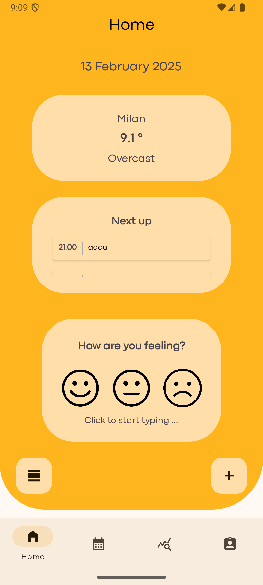
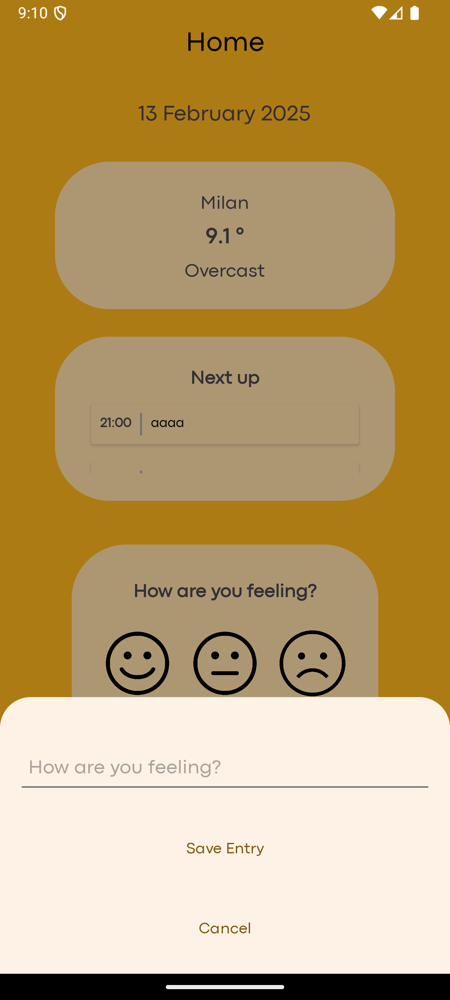
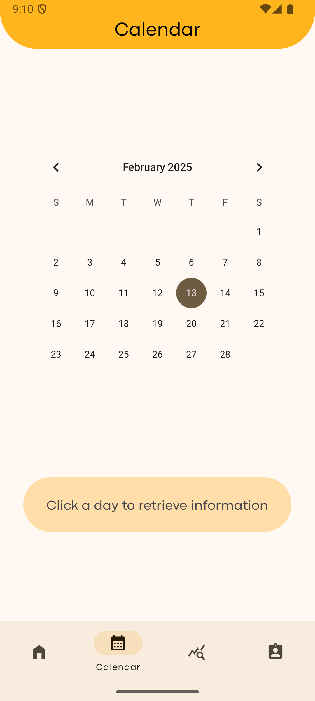
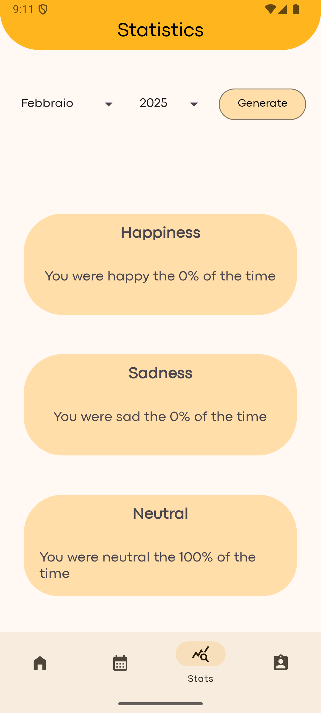

# Treasure 📔

**Treasure** is an Android mood-tracking diary. Every day you record how you're
feeling with a simple face (sad / neutral / happy) and an optional journal note,
keep track of your upcoming events on a calendar, and review monthly statistics
about your mood. The current weather is saved together with each entry, so you
can see how the weather relates to how you feel.

The app was developed as a project for the *Programmazione di Dispositivi Mobili*
(Mobile Application Development) course.

<p align="center">
  
  
  
  
</p>

---

## Features

- **Authentication** — sign up / log in with email + password or with Google,
  backed by Firebase Authentication.
- **Daily feelings** — record your mood (sad / neutral / happy) and write a
  free-text note for the day.
- **Events** — add and view upcoming events ("Impegni") organized by date.
- **Calendar** — browse your entries and events on a monthly calendar view.
- **Statistics** — monthly breakdown of how often you felt happy / neutral / sad.
- **Weather** — the current weather is fetched from WeatherAPI.com and stored
  with each feeling to enrich the statistics.
- **Profile & settings** — manage your account, change password and log out.
- **Offline-first** — data is cached locally with Room and synced with Firebase.

---

## Tech stack

| Area | Technology |
|------|------------|
| Language | Java |
| Min / Target SDK | 24 / 34 |
| UI | AndroidX, Material Components, Navigation Component, ConstraintLayout |
| Architecture | MVVM + Repository pattern with remote/local data sources |
| Auth & remote DB | Firebase Authentication, Firebase Realtime Database, Google Sign-In |
| Local DB | Room |
| Networking | Retrofit + Gson (WeatherAPI.com) |
| Build | Gradle (Kotlin DSL) |

---

## Architecture

The app follows an MVVM + Repository structure that separates UI, business logic
and data access:

```
ui/         Activities, Fragments and ViewModels (welcome + home flows)
repository/ Repositories that coordinate local and remote data
source/     Data sources (Firebase / Room / Weather remote & local / mock)
database/   Room databases and DAOs (Event, Feeling, Weather)
model/      Domain models (User, Feeling, Event, Weather, ...)
service/    Retrofit service for WeatherAPI.com
util/       Helpers (parsing, networking, ServiceLocator, constants, ...)
```

- **WelcomeActivity** hosts the login / signup flow.
- **HomeActivity** hosts the main flow: daily home, new feeling, new event,
  calendar, monthly statistics and profile settings.
- A **ServiceLocator** provides repository instances to the ViewModels.

---

## Getting started

### Prerequisites

- Android Studio (latest stable)
- A Firebase project
- A free [WeatherAPI.com](https://www.weatherapi.com/) API key

### Setup

1. **Clone the repository**

   ```bash
   git clone <repo-url>
   cd Treasure
   ```

2. **Configure Firebase**

   Create a Firebase project, enable **Authentication** (Email/Password and
   Google) and the **Realtime Database**, then download your
   `google-services.json` into the `app/` directory.

3. **Configure local properties**

   Add the following keys to `local.properties` (this file is not committed):

   ```properties
   weatherapi_key=YOUR_WEATHERAPI_KEY
   debug_mode=false
   ```

   > `debug_mode=true` uses a bundled mock weather response
   > (`app/src/main/assets/sample_weather_api.json`) instead of calling the
   > live API.

4. **Build & run**

   Open the project in Android Studio and run the `app` configuration on an
   emulator or device, or from the command line:

   ```bash
   ./gradlew installDebug
   ```

---

## Documentation

Detailed project documentation and the presentation slides are available in the
[`documentazione/`](documentazione/) folder:

- `Documentazione PDM - BAM.pdf`
- `Presentazione PDM - BAM.pdf`

---

## Authors

**Group "BAM"**

- Sala Anna Rebecca — 894569
- Pierfelice Benedetta — 899669
- Zylfo Matteo — 900114
